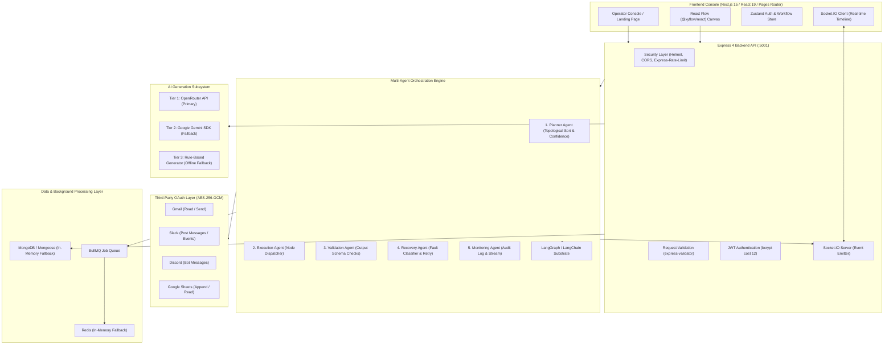
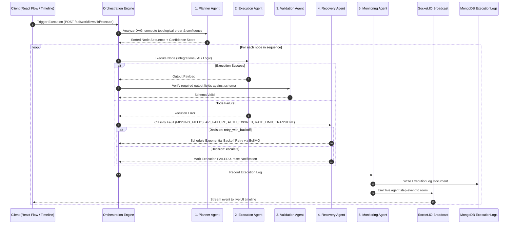
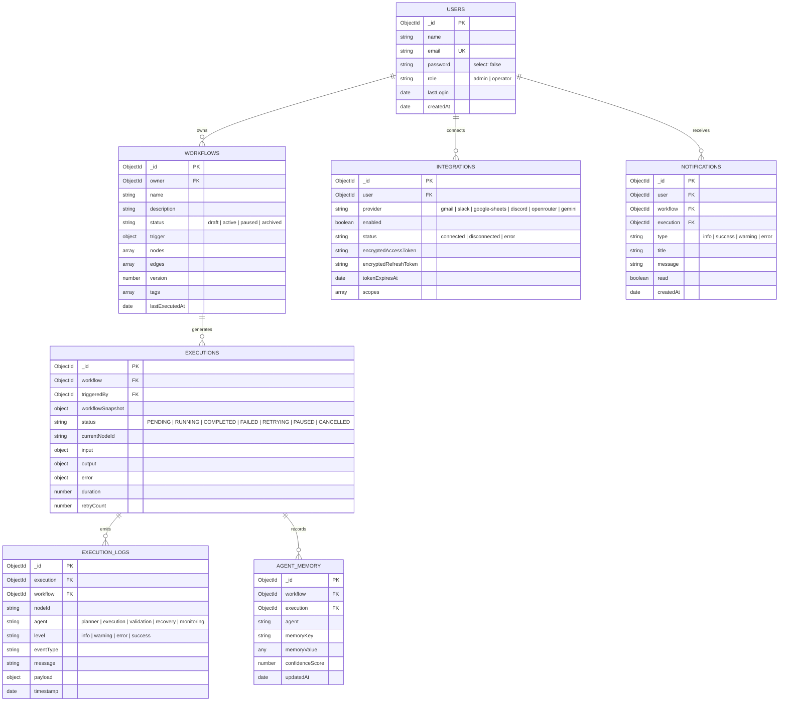

# Agentflow_AI — Agentic AI Operations Automation Platform

[](https://nodejs.org/)
[](https://nextjs.org/)
[](https://react.dev/)
[](https://expressjs.com/)
[](https://tailwindcss.com/)
[](https://reactflow.dev/)
[](https://socket.io/)
[](https://www.docker.com/)

> **Specification Authority:** This project and documentation strictly adhere to [specai.md](file:///Users/namanukarkera/Desktop/AI%20AUTOMATION/specai.md) as the single source of truth.

Agentflow_AI is an enterprise-grade AI Operations Automation Platform that empowers operators to describe automations in plain English and transforms them into executable, visual workflows. The platform generates workflow graphs from natural-language prompts, renders them on a drag-and-drop canvas, coordinates multi-step tasks across a 5-agent orchestration chain, interfaces with third-party tools (Gmail, Slack, Discord, Google Sheets) over OAuth, schedules jobs via BullMQ and Redis, streams live agent reasoning over Socket.IO, and retains a tamper-evident audit timeline in MongoDB.

---

## Table of Contents

1. [Architectural Overview](#-architectural-overview)
2. [Multi-Agent Orchestration Chain](#-multi-agent-orchestration-chain)
3. [AI Workflow Generation & 3-Tier Fallback](#-ai-workflow-generation--3-tier-fallback)
4. [Tech Stack](#-tech-stack)
5. [Frontend Application Map](#-frontend-application-map)
6. [Backend Architecture & Database Collections](#-backend-architecture--database-collections)
7. [Comprehensive API Reference](#-comprehensive-api-reference)
8. [Third-Party Integrations & OAuth](#-third-party-integrations--oauth)
9. [Security & Cryptography](#-security--cryptography)
10. [Environment Variables Reference](#-environment-variables-reference)
11. [Project Directory Layout](#-project-directory-layout)
12. [Development Phases Summary](#-development-phases-summary)
13. [Deployment Guide](#-deployment-guide)
    - [Method 1: Local Development (Zero-Dependency)](#method-1-local-development-zero-dependency)
    - [Method 2: Docker & Docker Compose (Production Stack)](#method-2-docker--docker-compose-production-stack)
    - [Method 3: Production VPS / Bare-Metal (PM2)](#method-3-production-vps--bare-metal-pm2)
    - [Method 4: Cloud Native (Vercel + Render / Railway)](#method-4-cloud-native-vercel--render--railway)
    - [Production Nginx Reverse Proxy & SSL](#production-nginx-reverse-proxy--ssl)
14. [Verification & Health Checks](#-verification--health-checks)

---

## 🏗 Architectural Overview

Agentflow_AI separates concerns into a clean, decoupled full-stack architecture:



---

## 🧠 Multi-Agent Orchestration Chain

Every workflow run is executed through a deterministic 5-stage agent chain:



### Agent Roles & Specifications:
1. **Planner Agent**: Performs topological sort on workflow graph nodes, detects cyclical dependencies, and assigns an execution plan confidence score.
2. **Execution Agent**: Dispatches each node to its respective handler (third-party OAuth integration, AI prompt provider, or branching/delay logic).
3. **Validation Agent**: Inspects node output payloads against required schemas and flags missing or malformed attributes.
4. **Recovery Agent**: Classifies failure modes (`MISSING_FIELDS`, `API_FAILURE`, `AUTH_EXPIRED`, `RATE_LIMIT`, `TRANSIENT`) and dynamically determines whether to `retry_with_backoff` or `escalate`.
5. **Monitoring Agent**: Emits structured timeline events (`info`, `warning`, `error`, `success`), writes persistent `ExecutionLog` entries, and triggers Socket.IO broadcasts to connected clients.

---

## 🤖 AI Workflow Generation & 3-Tier Fallback

The prompt-to-workflow engine takes natural language descriptions and converts them into structured React Flow graphs (nodes, positions, labels, configs, and edges):

```
┌─────────────────────────────────────────────────────────────┐
│ 1. OpenRouter API (Primary)                                 │
│    - Triggered when OPENROUTER_API_KEY is configured        │
│    - Uses high-capability LLMs (e.g., Anthropic Claude / GPT) │
└──────────────────────────────┬──────────────────────────────┘
                               │ (fallback on missing key or failure)
                               ▼
┌─────────────────────────────────────────────────────────────┐
│ 2. Google Gemini SDK (Secondary Fallback)                   │
│    - Triggered when GEMINI_API_KEY is configured            │
│    - Uses Google Generative AI SDK (@google/generative-ai)  │
└──────────────────────────────┬──────────────────────────────┘
                               │ (fallback on missing key or failure)
                               ▼
┌─────────────────────────────────────────────────────────────┐
│ 3. Deterministic Rule-Based Builder (Offline Guarantee)     │
│    - Zero external API dependencies                         │
│    - Produces valid, runnable graphs for key patterns:      │
│      • Email triage & invoice routing                       │
│      • Slack / Discord notification fanout                  │
│      • Google Sheets data append workflows                  │
│      • Webhook-to-AI processing pipelines                   │
└─────────────────────────────────────────────────────────────┘
```

### Supported Node Catalog Categories:
- **Triggers**: Webhook, Manual Trigger, Schedule/Cron, Integration Events (Gmail incoming, Slack event).
- **Actions**: Gmail Send, Slack Message, Discord Bot Announcement, Google Sheets Append Row, HTTP Request.
- **AI Nodes**: LLM Prompt Generation, Document Summarizer, Entity Extraction, Sentiment Classifier.
- **Logic Nodes**: Conditional Branch (`if/else`), Loop/Iterator, Data Transform, Delay/Timer.

---

## 📊 Tech Stack

| Domain | Technology | Version | Purpose |
|---|---|---|---|
| **Frontend Framework** | Next.js (Pages Router) | 15.5+ | SSR/SSG Operator Console |
| **Frontend UI Library** | React & React DOM | 19.2+ | Modern reactive component tree |
| **Styling** | Tailwind CSS & PostCSS | 3.4+ | Utility-first responsive design |
| **Workflow Canvas** | React Flow (`@xyflow/react`) | 12.3+ | Visual DAG workflow builder |
| **Client State** | Zustand | 4.5+ | Persistent auth & workflow state |
| **Icons** | lucide-react | 0.453+ | Clean operator console iconography |
| **Backend Runtime** | Node.js | v20+ (LTS) | Asynchronous backend runtime |
| **HTTP Framework** | Express | 4.21+ | REST API & routing layer |
| **Database** | MongoDB / Mongoose | 8.7+ | Document persistence (with in-memory fallback) |
| **Background Queue** | BullMQ & ioredis | 5.21+ / 5.4+ | Distributed job queue & retry backoff |
| **Real-Time WebSockets**| Socket.IO | 4.8+ | Live agent event & timeline streaming |
| **AI SDKs** | Google GenAI & OpenRouter | 0.21+ | LLM workflow generation |
| **Agentic Framework** | LangGraph & LangChain Core | 1.5+ / 1.3+ | Multi-agent substrate support |
| **Security & Cryptography**| Helmet, bcryptjs, crypto | 8.0+ / 2.4+ | AES-256-GCM token encryption, bcrypt cost 12 |
| **Request Validation** | express-validator | 7.2+ | Schema validation on all inbound requests |

---

## 📱 Frontend Application Map

| Route | Page File | Components & Capabilities |
|---|---|---|
| `/` | `client/src/pages/index.jsx` | Landing page, platform overview, multi-agent showcase, CTA buttons, dark theme, session redirect. |
| `/login` | `client/src/pages/login.jsx` | Operator login, JWT authentication flow, Zustand session persistence, error feedback. |
| `/register` | `client/src/pages/register.jsx` | User account onboarding, password strength validation, role assignment (`operator` / `admin`). |
| `/dashboard` | `client/src/pages/dashboard.jsx` | Operator console, `MetricGrid`, active workflow stats, recent executions, success rate indicators, AI activity feeds. |
| `/workflows/builder` | `client/src/pages/workflows/builder.jsx` | **AI prompt-to-workflow studio**: `PromptInputPanel`, `WorkflowCanvas`, `GraphPreviewPanel`, `WorkflowToolbar`, graph validation, save & execute. |
| `/workflows/[id]` | `client/src/pages/workflows/[id].jsx` | Full visual DAG editor: `NodePalette` (drag-and-drop), `WorkflowCanvas`, `NodeConfigPanel`, versioning, execution trigger, live node logs. |
| `/executions` | `client/src/pages/executions.jsx` | Execution control center: execution status, live Socket.IO timeline, retry, pause, resume, cancel, filtering, and logs. |
| `/integrations` | `client/src/pages/integrations.jsx` | Third-party provider management: Gmail, Slack, Discord, Google Sheets, OAuth connect/reconnect, credentials health check, toggle enable/disable. |
| `/settings` | `client/src/pages/settings.jsx` | User profile, security controls, AES encryption key health check, AI provider configuration status, notification preferences, logout. |

---

## 🗄 Backend Architecture & Database Collections

### Architecture Layers (`server/src/`):
- **`config/`**: Centralized environment validation (`env.js`), Mongo connection (`db.js`), and Socket.IO initialization (`socket.js`).
- **`middleware/`**: JWT authentication (`auth.js`), express-validator enforcement (`validate.js`), security headers & CORS (`security.js`), global error handling (`errorHandler.js`).
- **`controllers/`**: Thin HTTP parsing and response shaping. **Never communicates directly with the database.**
- **`services/`**: Business logic layer (workflow CRUD, execution lifecycle, token encryption, retry classification, notification dispatch).
- **`agents/`**: Pure agent modules (`plannerAgent.js`, `executionAgent.js`, `validationAgent.js`, `recoveryAgent.js`, `monitoringAgent.js`, `orchestrator.js`). Independent of HTTP.
- **`integrations/`**: Encapsulated third-party drivers conforming to `baseIntegration.js`.
- **`queues/`**: BullMQ and Redis queue configuration (`workflowQueue.js`, `executionQueue.js`, `redis.js`) with automatic in-memory queue fallback.
- **`models/`**: Mongoose schemas and unified model adapters.

### Database Collections:



---

## 📡 Comprehensive API Reference

All protected endpoints require `Authorization: Bearer <JWT_TOKEN>`.

### 1. System Health
| Method | Endpoint | Access | Description |
|---|---|---|---|
| `GET` | `/api/health` | Public | Heartbeat, service uptime, database/queue fallback status, encryption health. |

### 2. Authentication
| Method | Endpoint | Access | Payload | Description |
|---|---|---|---|---|
| `POST` | `/api/auth/register` | Public | `{ name, email, password, role? }` | Register new user account (bcrypt cost 12). |
| `POST` | `/api/auth/login` | Public | `{ email, password }` | Authenticate user and issue JWT token. |
| `GET` | `/api/auth/me` | Protected | None | Return authenticated profile & role. |

### 3. Workflows
| Method | Endpoint | Access | Payload / Params | Description |
|---|---|---|---|---|
| `GET` | `/api/workflows/dashboard` | Protected | None | Aggregated metrics, counts, success rates. |
| `GET` | `/api/workflows` | Protected | `?search=&status=&page=&limit=` | List owned workflows with pagination and filters. |
| `POST` | `/api/workflows` | Protected | `{ name, description, nodes, edges, trigger, tags }` | Create workflow manually. |
| `POST` | `/api/workflows/generate` | Protected | `{ prompt }` | **AI prompt-to-workflow generation** (3-tier fallback). |
| `GET` | `/api/workflows/:id` | Protected | `:id` (Workflow ID) | Get complete workflow definition and nodes. |
| `PUT` | `/api/workflows/:id` | Protected | `:id`, `{ name, nodes, edges, status, tags }` | Update workflow graph, configurations, or version. |
| `POST` | `/api/workflows/:id/duplicate`| Protected | `:id` | Clone workflow with duplicated nodes and metadata. |
| `POST` | `/api/workflows/:id/execute` | Protected | `:id`, `{ inputPayload? }` | Enqueue and start multi-agent workflow execution. |
| `DELETE`| `/api/workflows/:id` | Protected | `:id` | Archive or delete workflow. |

### 4. Executions & Lifecycle
| Method | Endpoint | Access | Payload / Params | Description |
|---|---|---|---|---|
| `GET` | `/api/executions` | Protected | `?workflow=&status=&page=&limit=` | List all executions with duration, retries, and state. |
| `GET` | `/api/executions/:id` | Protected | `:id` (Execution ID) | Get execution details, outputs, snapshot, errors. |
| `GET` | `/api/executions/:id/timeline` | Protected | `:id` | Get chronologically ordered agent execution logs. |
| `POST` | `/api/executions/:id/pause` | Protected | `:id` | Pause an active execution run. |
| `POST` | `/api/executions/:id/resume` | Protected | `:id` | Resume a paused execution. |
| `POST` | `/api/executions/:id/cancel` | Protected | `:id` | Abort a running execution and cleanup jobs. |
| `POST` | `/api/executions/:id/retry` | Protected | `:id` | Retry a failed execution with preserved inputs. |

### 5. Third-Party Integrations
| Method | Endpoint | Access | Payload / Params | Description |
|---|---|---|---|---|
| `GET` | `/api/integrations` | Protected | None | List all configured providers for current operator. |
| `GET` | `/api/integrations/status` | Protected | None | Provider connectivity status and expiration monitor. |
| `GET` | `/api/integrations/oauth/:provider/start` | Protected | `:provider` (`gmail`, `slack`, `discord`, `google-sheets`) | Initiate OAuth 2.0 flow and get authorization URL. |
| `GET` | `/api/integrations/oauth/:provider/callback` | Public | Query params from OAuth redirect | Process authorization code, encrypt and store tokens. |
| `GET` | `/api/integrations/oauth/error` | Public | Query params | OAuth diagnostic error landing. |
| `POST` | `/api/integrations` | Protected | `{ provider, apiKey, config }` | Manually store API keys or provider configs. |
| `POST` | `/api/integrations/:provider/test` | Protected | `:provider` | Ping integration endpoint to verify live connection. |
| `PATCH`| `/api/integrations/:provider/enabled` | Protected | `:provider`, `{ enabled }` | Toggle integration active/inactive. |

### 6. Notifications
| Method | Endpoint | Access | Payload / Params | Description |
|---|---|---|---|---|
| `GET` | `/api/notifications` | Protected | None | List notification alerts for current user. |
| `PATCH`| `/api/notifications/:id/read` | Protected | `:id` | Mark notification as read. |

---

## 🔌 Third-Party Integrations & OAuth

| Provider | Supported Operations | Authentication Type | Error Classification |
|---|---|---|---|
| **Gmail** | `send_email`, `read_emails` | OAuth 2.0 (Google Cloud Console) | `AUTH_EXPIRED`, `INTEGRATION_NOT_CONNECTED` |
| **Slack** | `post_message`, `list_channels`, Event Webhook | OAuth 2.0 / Bot Token (Slack API) | `RATE_LIMIT`, `AUTH_EXPIRED` |
| **Discord** | `post_message`, `get_guild_info` | Bot Token / OAuth 2.0 | `API_FAILURE`, `AUTH_EXPIRED` |
| **Google Sheets** | `append_row`, `read_range` | OAuth 2.0 (Google Drive / Sheets API) | `MISSING_FIELDS`, `AUTH_EXPIRED` |

> 🔒 **Token Protection:** All access tokens and refresh tokens are encrypted at rest using AES-256-GCM via `CREDENTIAL_ENCRYPTION_KEY`. Tokens are never output in API responses or written to log files.

---

## 🔒 Security & Cryptography

1. **Password Hashing**: User passwords hashed using `bcryptjs` with work cost factor 12.
2. **JWT Authentication**: JSON Web Tokens signed with HMAC-SHA256 using `JWT_SECRET` (enforced minimum 32 characters in production).
3. **Symmetric Encryption**: OAuth credentials encrypted at rest with `AES-256-GCM` using a 32-byte hexadecimal key (`CREDENTIAL_ENCRYPTION_KEY`).
4. **HTTP Header Hardening**: Automated security headers via `helmet` (HSTS, Content Security Policy, X-Frame-Options, DNS Prefetch Control).
5. **CORS Control**: Access strictly bounded to configured `CLIENT_URL`.
6. **Rate Limiting**: Auth endpoints guarded by `express-rate-limit` (100 requests per 15-minute window per IP).
7. **Input Validation**: All incoming requests validated and sanitized via `express-validator` middleware before hitting controllers.
8. **Explicit Error Boundaries**: Missing credentials surface explicitly as `INTEGRATION_NOT_CONNECTED` or `AUTH_EXPIRED` rather than generic server errors.

---

## ⚙️ Environment Variables Reference

### Backend (`server/.env`)
```bash
# ==========================================
# Server Runtime
# ==========================================
PORT=5001
NODE_ENV=production                         # development | production | test
CLIENT_URL=http://localhost:3000           # Allowed CORS origin

# ==========================================
# Database & Cache (Optional in Dev - Fallbacks active)
# ==========================================
MONGODB_URI=mongodb://localhost:27017/agentflow_ai
REDIS_URL=redis://localhost:6379

# ==========================================
# Security & Cryptography (Required)
# ==========================================
JWT_SECRET=agentflow_super_secret_jwt_key_development_32charsmin!
JWT_EXPIRES_IN=7d
CREDENTIAL_ENCRYPTION_KEY=0123456789abcdef0123456789abcdef0123456789abcdef0123456789abcdef

# ==========================================
# AI Model Providers (Optional - Deterministic builder works offline)
# ==========================================
OPENROUTER_API_KEY=                         # Primary AI model key
GEMINI_API_KEY=                             # Fallback Google Gemini key

# ==========================================
# OAuth Third-Party Integrations
# ==========================================
GMAIL_CLIENT_ID=
GMAIL_CLIENT_SECRET=
GMAIL_REDIRECT_URI=http://localhost:5001/api/integrations/oauth/gmail/callback

SLACK_CLIENT_ID=
SLACK_CLIENT_SECRET=
SLACK_REDIRECT_URI=http://localhost:5001/api/integrations/oauth/slack/callback

DISCORD_CLIENT_ID=
DISCORD_CLIENT_SECRET=
DISCORD_BOT_TOKEN=
DISCORD_REDIRECT_URI=http://localhost:5001/api/integrations/oauth/discord/callback

GOOGLE_SHEETS_CLIENT_ID=
GOOGLE_SHEETS_CLIENT_SECRET=
GOOGLE_SHEETS_REDIRECT_URI=http://localhost:5001/api/integrations/oauth/google-sheets/callback
```

### Frontend (`client/.env.local`)
```bash
NEXT_PUBLIC_API_URL=http://localhost:5001/api
NEXT_PUBLIC_SOCKET_URL=http://localhost:5001
```

---

## 📁 Project Directory Layout

```
AI AUTOMATION/
├── client/                               # Frontend Next.js Application
│   ├── Dockerfile                        # Multi-stage production container build
│   ├── next.config.js                    # Next.js configuration
│   ├── tailwind.config.js                # Tailwind styling config
│   ├── postcss.config.js                 # PostCSS plugin definitions
│   ├── package.json                      # Frontend dependencies (React 19, Next 15)
│   └── src/
│       ├── components/
│       │   ├── AppShell/                 # Main responsive layout shell & sidebar
│       │   ├── MetricGrid/               # KPI & analytics dashboard widgets
│       │   ├── NodePalette/              # Drag-from-palette node library
│       │   ├── NodeConfigPanel/          # Right-side selected node inspector
│       │   ├── WorkflowCanvas/           # React Flow interactive DAG canvas
│       │   ├── AgentflowNode/            # Custom styled nodes with status indicators
│       │   └── ProtectedRoute/           # Route guard checking Zustand auth state
│       ├── pages/
│       │   ├── index.jsx                 # Landing page & feature showcase
│       │   ├── login.jsx                 # Operator sign-in
│       │   ├── register.jsx              # Operator registration
│       │   ├── dashboard.jsx             # Operations control center
│       │   ├── executions.jsx            # Runs list & live timeline
│       │   ├── integrations.jsx          # OAuth status & connection management
│       │   ├── settings.jsx              # Profile, security, key health
│       │   └── workflows/
│       │       ├── builder.jsx           # AI prompt-to-workflow studio
│       │       └── [id].jsx              # Full workflow visual editor
│       ├── store/
│       │   ├── authStore.js              # Zustand JWT & user store with localStorage persist
│       │   └── workflowStore.js          # Active workflow state, undo/redo, node selections
│       ├── lib/
│       │   ├── api.js                    # Axios instance with interceptors & auth injection
│       │   ├── socket.js                 # Socket.IO connection singleton
│       │   └── nodeCatalog.js            # Node definitions, parameters, and input/output contracts
│       └── styles/
│           └── globals.css               # Tailwind global styles
│
├── server/                               # Backend Express & Multi-Agent Engine
│   ├── Dockerfile                        # Alpine Node 20 production container build
│   ├── package.json                      # Backend dependencies
│   └── src/
│       ├── app.js                        # Express app setup, middlewares & router mounting
│       ├── index.js                      # HTTP & Socket.IO server bootstrap & graceful shutdown
│       ├── config/
│       │   ├── env.js                    # Environment validator and config loader
│       │   ├── db.js                     # MongoDB connection with in-memory fallback
│       │   └── socket.js                 # Socket.IO initialization and room broadcasting
│       ├── routes/
│       │   ├── authRoutes.js             # /api/auth routes
│       │   ├── workflowRoutes.js         # /api/workflows routes
│       │   ├── executionRoutes.js        # /api/executions routes
│       │   ├── integrationRoutes.js      # /api/integrations routes
│       │   └── notificationRoutes.js     # /api/notifications routes
│       ├── controllers/
│       │   ├── authController.js         # Auth controller
│       │   ├── workflowController.js     # Workflow controller
│       │   ├── executionController.js    # Execution lifecycle controller
│       │   ├── integrationController.js  # OAuth & integration controller
│       │   └── notificationController.js # Notifications controller
│       ├── services/
│       │   ├── authService.js            # User authentication logic
│       │   ├── workflowService.js        # Workflow CRUD & versioning
│       │   ├── executionService.js       # Execution tracking & state machine
│       │   ├── orchestrationService.js   # Multi-agent coordination bridge
│       │   ├── integrationService.js     # Token encryption & provider dispatch
│       │   ├── notificationService.js    # System notification management
│       │   └── aiWorkflowGenerator.js    # 3-tier prompt-to-graph AI generator
│       ├── agents/
│       │   ├── orchestrator.js           # Multi-agent pipeline controller
│       │   ├── plannerAgent.js           # Topological sorting & confidence scoring
│       │   ├── executionAgent.js         # Dispatcher to integrations & logic
│       │   ├── validationAgent.js        # Payload schema validation
│       │   ├── recoveryAgent.js          # Failure classification & retry decisions
│       │   └── monitoringAgent.js        # Logging & real-time socket events
│       ├── integrations/
│       │   ├── baseIntegration.js        # Abstract provider interface
│       │   ├── gmail.js                  # Gmail OAuth & API handler
│       │   ├── slack.js                  # Slack Web API & webhook handler
│       │   ├── discord.js                # Discord Bot API client
│       │   └── googleSheets.js           # Google Sheets API client
│       ├── queues/
│       │   ├── redis.js                  # Redis connection with in-memory fallback
│       │   ├── executionQueue.js         # BullMQ queue for workflow runs
│       │   └── workflowQueue.js          # BullMQ queue for scheduled triggers
│       ├── models/
│       │   ├── User.js                   # User collection schema
│       │   ├── Workflow.js               # Workflow collection schema
│       │   ├── Execution.js              # Execution collection schema
│       │   ├── ExecutionLog.js           # Detailed audit event log schema
│       │   ├── Integration.js            # Encrypted OAuth credentials schema
│       │   ├── Notification.js           # User notifications schema
│       │   ├── AgentMemory.js            # Multi-agent persistent reasoning memory
│       │   └── modelAdapter.js           # Seamless Mongo / MemoryStore interface
│       └── utils/
│           ├── apiError.js               # Structured operational error class
│           ├── asyncHandler.js           # Async route wrapper
│           ├── crypto.js                 # AES-256-GCM encryption & decryption
│           └── memoryStore.js            # Zero-dependency in-memory DB & queue fallback
│
├── docker-compose.yml                    # Multi-container production stack orchestration
├── .dockerignore                         # Docker build exclusion rules
├── .env.production.example               # Production environment variable template
├── package.json                          # Workspace root script runner
└── specai.md                             # Single source of truth specification
```

---

## 📅 Development Phases Summary

As specified in `specai.md`, the platform is organized across six core phases:

- **Phase 1: Project Initialization & Core Security**
  Next.js and Express foundation, MongoDB connection with in-memory fallback, JWT auth with bcrypt cost 12, Zustand auth persistence, `AppShell` layout, and security middleware.
- **Phase 2: Workflow Management & React Flow Canvas**
  Workflow CRUD, metrics aggregation, visual React Flow canvas, node palette drag-and-drop, right-hand node configuration panel, graph validation, and serialization.
- **Phase 3: AI Workflow Generation**
  Prompt-to-workflow generation engine with 3-tier fallback (OpenRouter → Google Gemini → Deterministic Rule Builder) and builder UI integration.
- **Phase 4: Multi-Agent Orchestration Engine**
  5-agent chain (Planner, Execution, Validation, Recovery, Monitoring), lifecycle state machine (pause, resume, cancel), retry backoff, and LangGraph substrate support.
- **Phase 5: Third-Party OAuth Integrations**
  Integration drivers for Gmail, Slack, Discord, and Google Sheets, AES-256-GCM token encryption, connection diagnostics, and integration management console.
- **Phase 6: Queues, Real-Time Streaming & Observability**
  BullMQ background queues with Redis (and in-memory fallback), live Socket.IO event broadcasting, execution timeline visualization, and notification drawer.

---

## 🚀 Deployment Guide

### Method 1: Local Development (Zero-Dependency)

The platform includes built-in in-memory fallback engines for MongoDB and Redis, allowing you to run the entire stack with Node.js alone without installing any databases.

```bash
# 1. Install workspace dependencies
npm run install:all

# 2. Run both backend and frontend concurrently
npm run dev
```

- **Frontend Console:** [http://localhost:3000](http://localhost:3000)
- **Backend API:** [http://localhost:5001/api](http://localhost:5001/api)
- **Health Check:** [http://localhost:5001/api/health](http://localhost:5001/api/health)

---

### Method 2: Docker & Docker Compose (Production Stack)

The root `docker-compose.yml` provisions a production-grade containerized cluster including MongoDB 7.0, Redis 7, the Express API with Socket.IO, and the Next.js production runner.

```bash
# 1. Copy and configure environment variables
cp .env.production.example .env

# 2. Build images and start all services in detached mode
docker compose up -d --build

# 3. Inspect container health
docker compose ps

# 4. View logs
docker compose logs -f
```

To stop the cluster:
```bash
docker compose down
```

---

### Method 3: Production VPS / Bare-Metal (PM2)

Deploying on Ubuntu/Debian or macOS servers using PM2 process manager:

#### 1. System Setup:
```bash
sudo apt update && sudo apt install -y nodejs npm mongodb redis-server
sudo systemctl enable --now mongodb redis-server
sudo npm install -g pm2
```

#### 2. Build the Application:
```bash
cd "/path/to/AI AUTOMATION"
npm run install:all

# Build frontend production bundle
npm run build
```

#### 3. Start with PM2:
Create an `ecosystem.config.js` file:
```javascript
module.exports = {
  apps: [
    {
      name: 'agentflow-backend',
      script: 'src/index.js',
      cwd: './server',
      instances: 'max',
      exec_mode: 'cluster',
      env: {
        NODE_ENV: 'production',
        PORT: 5001
      }
    },
    {
      name: 'agentflow-frontend',
      script: 'node_modules/next/dist/bin/next',
      args: 'start -p 3000',
      cwd: './client',
      instances: 1,
      exec_mode: 'fork',
      env: {
        NODE_ENV: 'production'
      }
    }
  ]
};
```

Run with PM2:
```bash
pm2 start ecosystem.config.js
pm2 save
pm2 startup
```

---

### Method 4: Cloud Native (Vercel + Render / Railway)

- **Frontend (Vercel):**
  1. Import the `/client` directory into Vercel.
  2. Framework preset: **Next.js**.
  3. Set Environment Variables:
     - `NEXT_PUBLIC_API_URL`: `https://api.yourdomain.com/api`
     - `NEXT_PUBLIC_SOCKET_URL`: `https://api.yourdomain.com`

- **Backend (Render / Railway / AWS ECS):**
  1. Set Root Directory to `/server`.
  2. Build Command: `npm install --omit=dev`
  3. Start Command: `node src/index.js`
  4. Attach managed MongoDB and Redis instances.
  5. Configure `JWT_SECRET`, `CREDENTIAL_ENCRYPTION_KEY`, and OAuth credentials.

---

### Production Nginx Reverse Proxy & SSL

Deploy Nginx in front of both services to terminate SSL and properly route HTTP and WebSocket traffic:

```nginx
# /etc/nginx/sites-available/agentflow
map $http_upgrade $connection_upgrade {
    default upgrade;
    ''      close;
}

server {
    listen 80;
    server_name agentflow.yourdomain.com;
    return 301 https://$host$request_uri;
}

server {
    listen 443 ssl http2;
    server_name agentflow.yourdomain.com;

    ssl_certificate /etc/letsencrypt/live/agentflow.yourdomain.com/fullchain.pem;
    ssl_certificate_key /etc/letsencrypt/live/agentflow.yourdomain.com/privkey.pem;
    ssl_protocols TLSv1.2 TLSv1.3;
    ssl_ciphers HIGH:!aNULL:!MD5;

    # Frontend Console (Next.js)
    location / {
        proxy_pass http://127.0.0.1:3000;
        proxy_http_version 1.1;
        proxy_set_header Host $host;
        proxy_set_header X-Real-IP $remote_addr;
        proxy_set_header X-Forwarded-For $proxy_add_x_forwarded_for;
        proxy_set_header X-Forwarded-Proto $scheme;
    }

    # Backend REST API
    location /api/ {
        proxy_pass http://127.0.0.1:5001/api/;
        proxy_http_version 1.1;
        proxy_set_header Host $host;
        proxy_set_header X-Real-IP $remote_addr;
        proxy_set_header X-Forwarded-For $proxy_add_x_forwarded_for;
        proxy_set_header X-Forwarded-Proto $scheme;
    }

    # Real-Time WebSocket Channel (Socket.IO)
    location /socket.io/ {
        proxy_pass http://127.0.0.1:5001/socket.io/;
        proxy_http_version 1.1;
        proxy_set_header Upgrade $http_upgrade;
        proxy_set_header Connection $connection_upgrade;
        proxy_set_header Host $host;
        proxy_cache_bypass $http_upgrade;
        proxy_read_timeout 86400s;
        proxy_send_timeout 86400s;
    }
}
```

Issue TLS Certificate:
```bash
sudo certbot --nginx -d agentflow.yourdomain.com
```

---

## 🩺 Verification & Health Checks

Verify your deployment with automated endpoint checks:

### 1. Test Backend Heartbeat
```bash
curl -s http://localhost:5001/api/health | jq
```
Expected output:
```json
{
  "success": true,
  "status": "healthy",
  "uptime": "5m 20s",
  "environment": "production",
  "services": {
    "database": "mongodb-connected",
    "queueEngine": "bullmq-or-fallback-ready",
    "socketServer": "active",
    "orchestration": "multi-agent-v1"
  },
  "security": {
    "jwtSecretConfigured": true,
    "credentialEncryptionKeyConfigured": true,
    "helmetEnabled": true,
    "corsRestricted": true
  },
  "version": "1.0.0"
}
```

### 2. Test Frontend Availability
```bash
curl -I http://localhost:3000
```
Expected output:
```http
HTTP/1.1 200 OK
X-Powered-By: Next.js
Content-Type: text/html; charset=utf-8
```

### 3. Verify Socket.IO Handshake
```bash
curl "http://localhost:5001/socket.io/?EIO=4&transport=polling"
```
Expected output starts with:
```
0{"sid":"...","upgrades":["websocket"],"pingInterval":25000,"pingTimeout":20000}
```

---

## 📜 License & Compliance

Built in accordance with the **Agentflow_AI Platform Specification** (`specai.md`).  
Protected under enterprise application security guidelines: AES-256-GCM token storage, strict JWT session verification, and OWASP-recommended HTTP header hardening.
